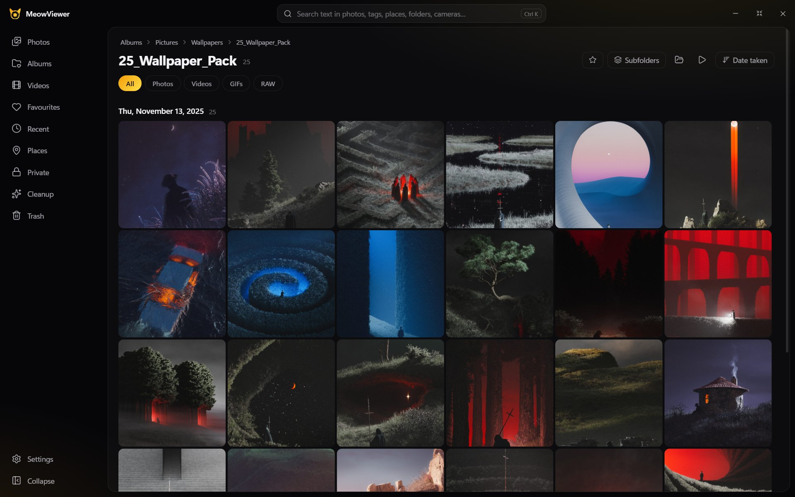
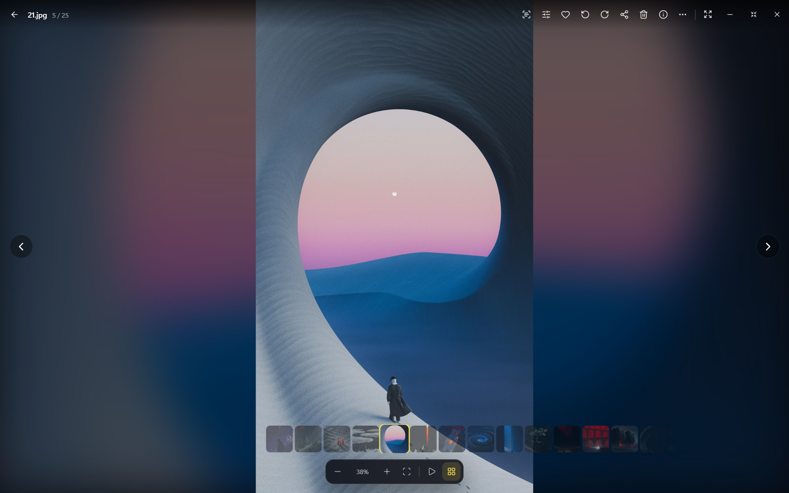
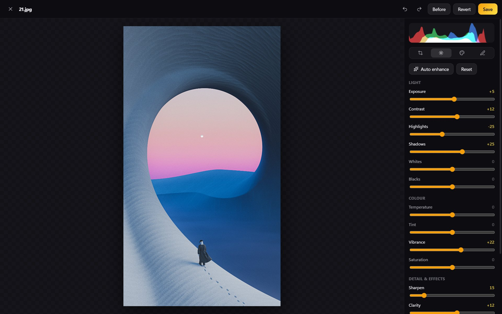
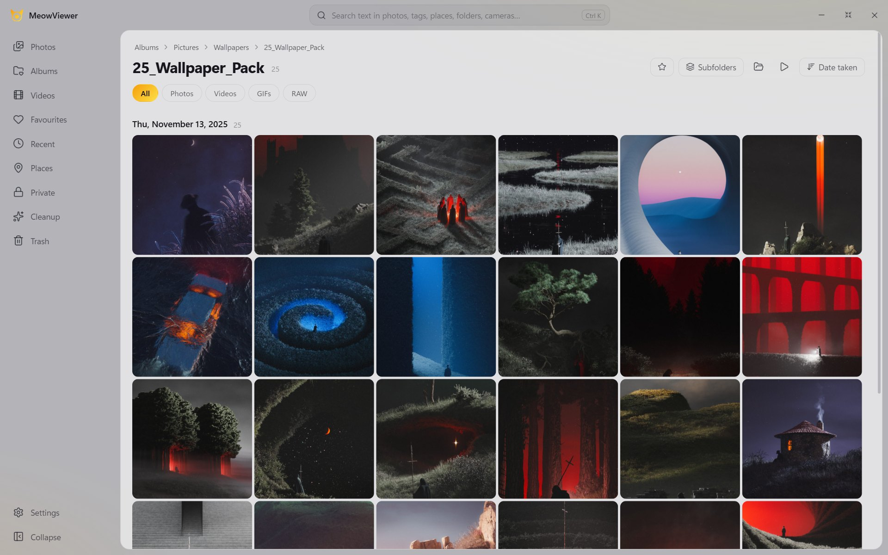

<div align="center">


# MeowViewer

**A fast, light photo & video viewer and gallery for Windows.**
Opens a photo instantly like the macOS viewer. Browses your whole library like a phone gallery.

[](https://github.com/AminMGM/MeowViewer/releases/latest)
[](https://github.com/AminMGM/MeowViewer/releases)
[](#install)
[](https://tauri.app)
[](LICENSE)

### [⬇ Download for Windows](https://github.com/AminMGM/MeowViewer/releases/latest)

</div>



---

## Why MeowViewer

|  |  |
|---|---|
| ⚡ **Instant** | Double-click a photo and it's on screen, sized to the image — no splash, no waiting. |
| 🪶 **Light** | About **150 MB of RAM** browsing a 12,000-item library. A 5 MB installer. |
| 🖼️ **Every format** | JPEG, PNG, WebP, AVIF, HEIC, RAW, PSD, TIFF, GIF… and every video format with the optional codec pack. |
| 📱 **A real gallery** | Timeline, albums, folders inside folders, auto-albums by app, a map of your photos, memories. |
| 🔎 **Finds text in photos** | Search screenshots and documents by the words in them — on-device, offline. |
| 🔒 **Private album** | Encrypted with your PIN. Hidden from everything else. |
| 🎨 **Looks good** | Frosted Windows 11 glass, light & dark, seven accent colours. |

## Screenshots

| | |
|---|---|
|  |  |
| **Viewer** — ambient background, filmstrip, auto-hiding controls | **Editor** — GPU adjustments, looks, markup, live histogram |
|  |  |
| **Light mode** — follows Windows, or pick it yourself | **Dark mode** — frosted Windows 11 glass |

## Install

1. Download **`MeowViewer_x.y.z_x64-setup.exe`** from the [latest release](https://github.com/AminMGM/MeowViewer/releases/latest).
2. Run it — it installs to *Program Files* (Windows asks for permission once). A short setup asks for your theme, library folders and optional extras.
3. Optional: *Settings → Default app* to open your photos and videos with MeowViewer.

Updates install themselves from this repository (signed releases).

## Features

<details open>
<summary><b>Viewer</b></summary>

- Opens from Explorer in a window sized to the photo; ← → moves through the folder
- Zoom to the cursor with the wheel or a touchpad pinch, drag to pan, double-click for 100% / fit
- Lossless JPEG/TIFF rotation — the orientation flag is rewritten in place, pixels untouched
- Ambient, dark or black background; controls that hide themselves; full screen; filmstrip; slideshow
- **Live Text** — select and copy text right off a photo or screenshot
- **Motion photos** from Samsung, Google and Pixel play with one click
- Info panel: camera, lens, exposure, RGB histogram, mini map, rating, description, tags, editable date and location
- Compare 2–4 photos side by side with synced zoom

</details>

<details>
<summary><b>Video player</b></summary>

- Glass controls, a seek bar that previews frames on hover, speed 0.25–3×, A-B loop, frame stepping
- Picks up where you left off; can play the next video automatically
- **Subtitles**: matching `.srt` / `.vtt` / `.ass` files and subtitles inside MKV files load automatically (no extra download), or load any file; right-to-left languages; size, colour, background, position and timing (G / H)
- Audio track switching, volume boost to 200%, equaliser presets
- Brightness, contrast, saturation, hue; aspect-ratio override; rotate; fill/fit
- Save a frame as PNG, picture-in-picture, always on top, jump to time (Ctrl+G)
- MP4, MOV, WebM and MKV play natively. The optional **codec pack** (FFmpeg, downloaded once) plays AVI, WMV, MPEG, TS, FLV and everything else

</details>

<details>
<summary><b>Gallery</b></summary>

- Photos timeline by day or month, a date bubble and year scrubber while scrolling, **On this day** memories
- Albums as a folder tree or a flat list, custom covers, hidden folders
- Your own albums, **smart albums** (saved searches) and tags
- Auto-albums by app: Camera, Screenshots, Screen recordings, WhatsApp, Telegram, Instagram, Downloads…
- **Places**: your photos on a map (dark "Shades of Grey" / light "Masik" styles)
- Search by name, folder, camera, app, tag, description and **text inside photos**
- Filters by type and rating, six sort orders, multi-select, Trash with restore and Undo
- OneDrive and Google Drive folders work out of the box — online-only files show thumbnails without downloading

</details>

<details>
<summary><b>Editor</b></summary>

- Crop with free or fixed ratios, rotate, flip, straighten
- Exposure, contrast, highlights, shadows, whites, blacks, temperature, tint, vibrance, saturation, sharpen, clarity, vignette, grain, fade — all on the GPU, instant
- Twelve looks, auto enhance, live histogram, before/after
- Markup: pen, highlighter, arrows, shapes, text, and blur / pixelate to hide faces or plates
- Save as a copy or over the original (a backup is kept). JPEG keeps the camera info, date and location

</details>

<details>
<summary><b>Private album, cleanup & sharing</b></summary>

- **Private album** — files are encrypted (XChaCha20-Poly1305, PIN through Argon2id), thumbnails too; locks itself when you leave or go idle
- **Cleanup** — storage by type and app, exact and similar duplicates, old screenshots, files over 50 MB, import from a camera or SD card
- **Share** — Windows share sheet, Telegram (desktop or Store), e-mail, Bluetooth, Nearby / Quick Share
- **Open in** Photoshop, Lightroom, Illustrator, GIMP, Affinity Photo or Paint.NET when installed
- Export / convert to JPEG, PNG, WebP, TIFF, BMP or GIF with resizing; location data is removed
- Copy image, set as wallpaper, print, search with Google Lens, desktop shortcuts

</details>

## Privacy

Everything happens on your PC. Text recognition uses the OCR built into Windows, offline. There are no
accounts, no analytics and no telemetry. The app only goes online for map tiles, the optional codec pack,
update checks, and Google Lens when you ask for it.

## Keyboard shortcuts

| Viewer | |
|---|---|
| ← → · Home / End | Previous / next · first / last |
| + − 0 1 | Zoom in / out / fit / 100% |
| R · Shift+R | Rotate right · left |
| F / F11 / Enter | Full screen |
| I · T · E · B | Info · Live Text · Edit · filmstrip |
| L | Favourite |
| F5 | Slideshow |
| Del | Move to Trash |
| Ctrl+C · Ctrl+P · F2 | Copy · print · rename |

| Video | |
|---|---|
| Space / K | Play / pause |
| ← → · J / L | Seek 5 s · 10 s |
| ↑ ↓ · M | Volume · mute |
| [ ] · , . | Speed · frame step |
| V · G / H | Subtitles · subtitle delay |
| Ctrl+G | Jump to time |

In the gallery: **Ctrl+K** search, **Ctrl + wheel** resizes thumbnails, **Alt+←** back.

## Under the hood

- **Tauri 2 + Rust** core: SQLite library index with a live file watcher, Windows shell thumbnails
  (cached, newest-first), Windows Imaging Component for HEIC/TIFF/RAW, Windows OCR, a range-capable
  media protocol so 4 GB videos stream in small chunks
- **React + Vite** interface with a virtualised grid that stays at the display's refresh rate with 100k items
- WebGL photo editor, MapLibre map loaded only when you open Places

## Build from source

Requirements: Node 20+, Rust (stable, MSVC), Visual Studio C++ Build Tools, Windows 10/11 SDK.

```bash
npm install
npm run dev        # run the app with hot reload
npm run dist       # build the installer → src-tauri/target/release/bundle/nsis
```

<details>
<summary><b>Publishing a release</b></summary>

The app's updater reads `latest.json` from the latest GitHub release.

1. Bump `version` in `package.json`, `src-tauri/tauri.conf.json` and `src-tauri/Cargo.toml`.
2. Make sure the repository secret `TAURI_SIGNING_PRIVATE_KEY` holds your updater private key.
3. `git tag vX.Y.Z && git push origin vX.Y.Z` — the **Release** workflow builds, signs and publishes the
   installer together with `latest.json`.

</details>

## Roadmap

- On-device AI: search by objects ("dog on beach"), people, background removal, upscaling
- Google Drive and OneDrive sync through their APIs
- Collage and GIF maker, trips, photo frame / rotating wallpaper

Ideas and bug reports are welcome in [Issues](https://github.com/AminMGM/MeowViewer/issues).

---

<div align="center">

Made with ❤️ by **[AminMGM](https://github.com/AminMGM)** · [MIT License](LICENSE)

</div>
